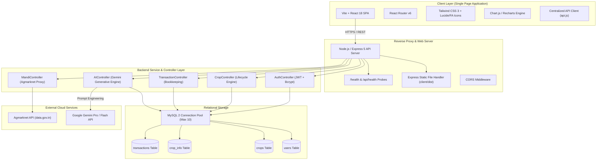
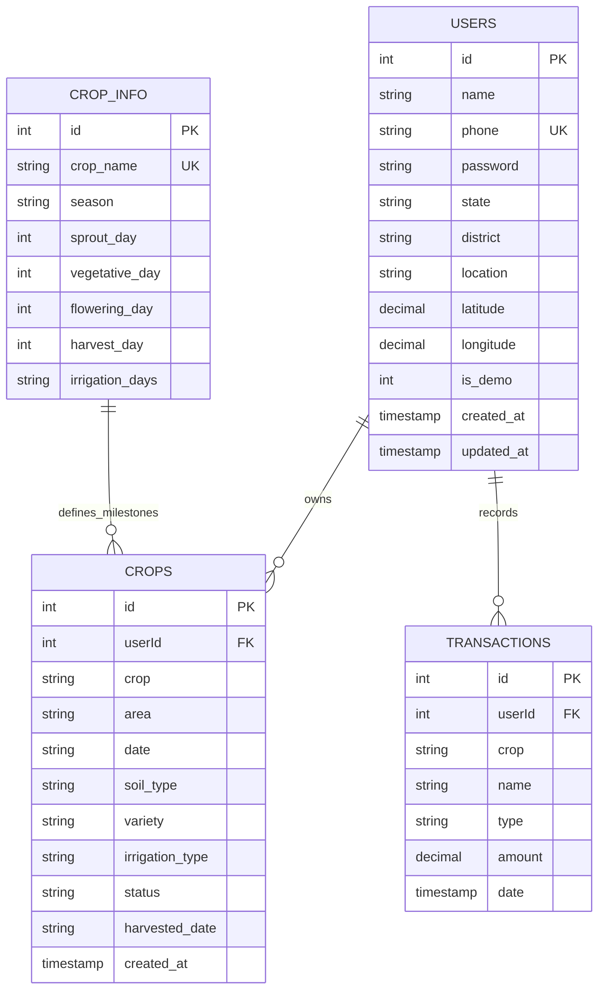
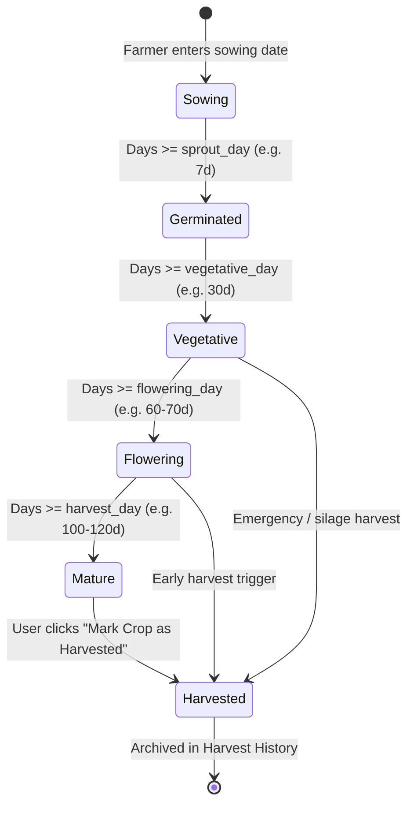
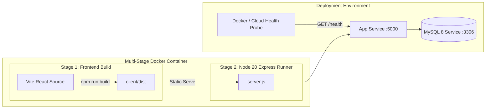

# 🏛️ FarmFriend — Architecture Design Rules & System Specifications

---

## 1. System Architecture Overview

FarmFriend follows a modern, decoupled client-server architecture with relational persistence and external AI/Data service integrations:



---

## 2. Core Architectural Design Rules

### Rule 1: Centralized Frontend API Configuration
- **Rule**: Never hardcode `http://localhost:5000` or raw URLs inside React components or hooks.
- **Implementation**: All network requests must consume `API_BASE_URL` exported from `client/src/config/api.js`.
- **Dynamic Resolution Logic**:
  1. If `import.meta.env.VITE_API_URL` is set, use it.
  2. If running in browser and hostname is not empty, use `window.location.origin` (facilitates unified Docker single-server container deployment).
  3. Fallback to `"http://localhost:5000"` for local Vite dev proxying.

### Rule 2: Express 5 Route & Wildcard Compliance
- **Rule**: Never use raw `*` in `app.get("*")` or `app.use("/api/*")` as Express 5 deprecates legacy `path-to-regexp` strings.
- **Implementation**:
  ```javascript
  // Express 5 compliant SPA fallback and API 404
  app.use((req, res) => {
    if (req.path.startsWith("/api")) {
      return res.status(404).json({ success: false, message: "API endpoint not found" });
    }
    if (fs.existsSync(clientDistPath)) {
      return res.sendFile(path.resolve(clientDistPath, "index.html"));
    }
    res.status(404).send("Not Found");
  });
  ```

### Rule 3: Database Connection Resiliency & Cloud Portability
- **Rule**: Database connectivity must support local developer setups, Dockerized bridge networks, and SSL-enforced cloud databases (e.g. Aiven, AWS RDS, Railway, PlanetScale).
- **Implementation**:
  - `port: Number(process.env.DB_PORT) || 3306`
  - `ssl: process.env.DB_SSL === "true" ? { rejectUnauthorized: false } : undefined`
  - Automatic `CREATE DATABASE IF NOT EXISTS` check with graceful catch to avoid startup panics on restricted cloud accounts.

### Rule 4: Zero-Blank Space UI Partitioning
- **Rule**: Main operational pages (`/finance` and `/crops`) must maintain consistent height proportions and zero orphaned layout gaps.
- **Implementation**:
  - `/finance` desktop view is split into an exact two-column grid (`lg:grid-cols-2 gap-8`):
    - Left column houses financial cards (2x2), primary CTA, recent transaction log, and interactive pie chart with crop swapper line.
    - Right column houses the complete AI Cost Advisor card spanning equal vertical height (`h-full flex flex-col`).

---

## 3. Database Schema & Relational Specifications



### Table Definitions & Constraints
1. **`users` Table**:
   - `id`: Auto-incrementing primary key.
   - `phone`: Unique 10-digit mobile number, indexed for $O(1)$ login lookups.
   - `password`: Stored as 60-character bcrypt hash (`$2a$10$...`).
   - `is_demo`: TINYINT flag identifying demo profile (`1`) vs standard users (`0`).
2. **`crops` Table**:
   - `userId`: Foreign key with `ON DELETE CASCADE`.
   - `date`: Sowing date stored in ISO string format (`YYYY-MM-DD`).
   - `status`: String flag (`'Active'` vs `'Harvested'`), defaults to `'Active'`.
   - `harvested_date`: Timestamp or string recorded upon trigger of the harvest action.
3. **`crop_info` Table**:
   - Holds scientific agronomical baseline milestone days for 15+ major Indian crops (Wheat, Rice, Maize, Soybean, Cotton, Sugarcane, Chana, Mustard, etc.).
4. **`transactions` Table**:
   - `userId`: Foreign key with `ON DELETE CASCADE`.
   - `crop`: Normalized crop association (`'Wheat'`, `'Soybean'`, `'Chana'`, or `'General'`).
   - `type`: Enum-like string (`'income'` vs `'expense'`).
   - `amount`: `DECIMAL(12, 2)` preventing floating-point rounding errors.

---

## 4. Crop Lifecycle State Machine



### Lifecycle Calculation Rules
- **Days Calculation**: $\Delta t = \lfloor \frac{\text{Date.now()} - \text{sowingDate}}{86400000} \rfloor$
- **Stage Classification Matrix**:
  | Stage Index | Label | Condition | Progress % | Action Alert |
  | :---: | :--- | :--- | :---: | :--- |
  | 0 | Seed / Sowing | $\Delta t < \text{sprout\_day}$ | $15\%$ | Initial watering & basal fertilizer dose |
  | 1 | Germinated / Sprout | $\text{sprout\_day} \le \Delta t < \text{vegetative\_day}$ | $35\%$ | Weed eradication & soil moisture check |
  | 2 | Vegetative Growth | $\text{vegetative\_day} \le \Delta t < \text{flowering\_day}$ | $60\%$ | Nitrogen top-dressing / Nano Urea spray |
  | 3 | Flowering & Pods | $\text{flowering\_day} \le \Delta t < \text{harvest\_day}$ | $85\%$ | Critical irrigation; pest & borer vigilance |
  | 4 | Ready for Harvest | $\Delta t \ge \text{harvest\_day}$ | $100\%$ | Grain moisture check; schedule combine harvester |
  | 5 | Harvested | `crop.status === 'Harvested'` | Complete | Record final yield & compute net crop profit |

---

## 5. API Specification & Interface Contracts

### Authentication Endpoints
- `POST /api/auth/register`:
  - Body: `{ name, phone, password, state, district, location }`
  - Success: `201 { success: true, message: "Registered successfully" }`
- `POST /api/auth/login`:
  - Body: `{ phone, password }`
  - Success: `200 { success: true, token, user: { id, name, phone, location } }`
- `POST /api/auth/demo-login`:
  - Success: `200 { success: true, token, user: { id: 6, name: "Ramesh Patel (Demo Farmer)", phone: "9999999999", is_demo: true } }`

### Crop Management Endpoints
- `GET /api/crops`: Retrieves all crops for authenticated `userId`.
- `POST /api/crops`: Registers a new crop.
- `PATCH /api/crops/:cropId/harvest`:
  - Body: `{ harvestedDate?: string }`
  - Response: `200 { success: true, message: "Crop marked as harvested successfully", crop: { ... } }`
- `DELETE /api/crops/:id`: Removes crop record.

### AI Agronomist & Finance Endpoints
- `POST /api/ai/crop-care`:
  - Body: `{ cropName, variety, soilType, daysElapsed, stage, question?: string }`
  - Response: `200 { success: true, advice: string, stageInfo: object }`
- `GET /api/ai/expense-recommendations`:
  - Response:
    ```json
    {
      "success": true,
      "topExpenses": [
        { "category": "Fertilizer", "total": 12500 }
      ],
      "costCuttingProducts": [
        {
          "name": "IFFCO Nano Urea (500 ml)",
          "category": "Fertilizer",
          "currentPrice": "₹225 / bottle",
          "replaces": "Conventional Urea (₹266 + ₹100 transport)",
          "savings": "Saves ₹140 per acre + 50% less soil degradation",
          "dosage": "4 ml/L water at active tillering/branching"
        }
      ],
      "aiAdvice": "..."
    }
    ```
- `GET /api/ai/pesticide-prices`:
  - Response: List of top 5 cost-saving pesticide & fungicide chemistries with exact Indian MRP rates.

---

## 6. Frontend Component Architecture & Standards

### File Organization
```
client/src/
├── api/                   # Normalized API interaction modules
│   ├── ai.js              # AI crop care & expense advisor endpoints
│   ├── crop.js            # Crop fetching, creation, deletion, harvest
│   └── transaction.js     # Transaction bookkeeping calls
├── components/            # Reusable UI domain components
│   ├── crops/
│   │   ├── AICropAdvisor.jsx   # Interactive Q&A & quick prompts
│   │   └── Cropcard.jsx        # Stepper, state drawer, harvest button
│   ├── finance/
│   │   ├── AIExpenseAdvisor.jsx # Cost-cutting products with MRPs
│   │   ├── ExpensePieChart.jsx  # Crop-filtered pie chart + swapper bar
│   │   └── Transactions.jsx     # Transaction modal & audit logs
│   ├── Mandi/
│   └── navbar/
├── config/
│   └── api.js             # Single source of truth for backend URL
└── pages/
    ├── crops.jsx          # Crop overview, KPI cards, filter tabs
    ├── finance.jsx        # 2-half split finance dashboard
    ├── login.jsx          # Auth + 1-click demo login
    └── register.jsx
```

### UI Style & Token Standards
- **Primary Color Palette**: Emerald / Green (`emerald-600`, `green-600`, `green-700`) conveying agriculture and vitality.
- **Accent & Neutral**: Amber for warning/pending, Indigo for technology/AI, Slate for typography.
- **Card Styling**: Consistent `bg-white rounded-2xl border border-gray-100 shadow-sm p-6`.
- **Button Tokens**:
  - Primary CTA: `bg-green-600 hover:bg-green-700 text-white font-medium px-4 py-2.5 rounded-xl shadow-sm transition-all`.
  - Secondary / Outline: `bg-gray-100 hover:bg-gray-200 text-gray-700 px-4 py-2 rounded-xl transition-all`.
  - Danger / Delete: `text-red-500 hover:text-red-700 hover:bg-red-50 p-2 rounded-lg`.

---

## 7. Containerization & Deployment Architecture



### Production Checklist
1. **Process Manager**: Container standard process or PM2 (`ecosystem.config.cjs`).
2. **Environment Isolation**: Production secrets provided strictly via container environment variables or Docker Secrets.
3. **Container Health Monitoring**: Automatic ping to `http://localhost:5000/health` every 30 seconds.
4. **SSL/TLS**: Terminated at Cloudflare / Nginx / Ingress Controller before passing to Node.js application.
