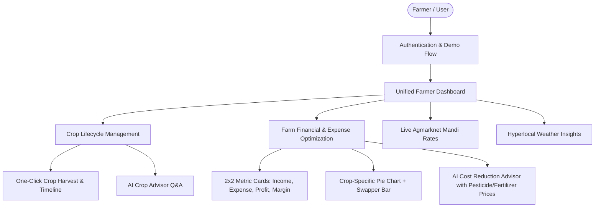

# 🌾 FarmFriend — Product Requirement Document (PRD)

---

## 1. Document Overview
- **Product Name**: FarmFriend (स्मार्ट किसान साथी)
- **Document Version**: 2.0.0 (Production Release)
- **Target Audience**: Indian Small and Marginal Farmers, Agritech Cooperatives, Agricultural Extension Officers, Rural Financial Analysts.
- **Project Repository**: `mama-sheesh/FarmFriend`
- **Current Release Status**: Deployment Ready

---

## 2. Executive Summary & Vision
**FarmFriend** is an intelligent, bilingual-ready agritech web platform engineered to empower smallholder farmers across India. It bridges critical information gaps in:
1. **Crop Lifecycle Management**: Tracking real growth stages (Germination $\to$ Vegetative $\to$ Flowering $\to$ Maturity $\to$ Harvest) with automated irrigation alerts and interactive AI agronomist support.
2. **Financial Management & Cost Optimization**: Replacing paper ledgers with clear farm bookkeeping, visual expense breakdowns per crop, and actionable AI recommendations for cheaper fertilizer and pesticide alternatives with real market rates.
3. **Mandi Market Intelligence**: Real-time mandi prices and historical price ranges across districts to negotiate fair prices.
4. **Immediate Frictionless Onboarding**: Single-click demo access allowing farmers and evaluators to experience full capabilities without SMS gateway friction.

---

## 3. User Personas

### Persona A: Ramesh Patel (Marginal Farmer, 3.5 Acres, Madhya Pradesh)
- **Profile**: Grows Sharbati Wheat (Rabi) and Soybean (Kharif). Limited digital literacy; relies on mobile smartphone with 4G.
- **Pain Points**:
  - Overpays retail agri-dealers for branded DAP and chemical insecticides.
  - Loses track of input costs per crop and miscalculates net profit.
  - Doesn't know the exact harvest maturity window, leading to grain moisture discount at mandi.
- **Needs in FarmFriend**:
  - Quick question prompt to AI ("What fertilizer should I apply at flowering?").
  - Cost comparison showing how much he saves using Nano Urea or Neem Oil.
  - Clean 2x2 financial overview without clutter.

### Persona B: Sunita Devi (Progressive Farmer & FPO Member, 8 Acres, Maharashtra)
- **Profile**: Diversified cropping (Chana, Cotton, Vegetables). Manages accounts for self and village cooperative.
- **Pain Points**:
  - Unstructured transaction logs across multiple family members.
  - No visual distribution of where inputs are concentrated (seeds vs fertilizers vs labor).
- **Needs in FarmFriend**:
  - Crop-specific expense pie chart with quick swapper to compare Chana vs Soybean costs.
  - Ability to mark crops as harvested and archive seasonal profitability.

### Persona C: Demo Evaluator / Agritech Investor / Agricultural Officer
- **Profile**: Evaluates platform UX and agronomical accuracy without creating throwaway accounts.
- **Needs in FarmFriend**:
  - 1-click demo login instantly populating realistic multi-crop lifecycle transitions and 14+ historical transactions.

---

## 4. Key Product Pillars & Feature Specifications

---

### Pillar 1: Crop Lifecycle & Stage Transition Management (`/crops`)
- **Stage Progression Model**:
  - Automatically calculates days elapsed from sowing date:
    - $\text{Days} < \text{sprout\_day} \implies$ **Seed / Sowing**
    - $\text{sprout\_day} \le \text{Days} < \text{vegetative\_day} \implies$ **Germinated / Sprout**
    - $\text{vegetative\_day} \le \text{Days} < \text{flowering\_day} \implies$ **Vegetative Growth**
    - $\text{flowering\_day} \le \text{Days} < \text{harvest\_day} \implies$ **Flowering & Grain Filling**
    - $\text{Days} \ge \text{harvest\_day} \implies$ **Mature / Ready for Harvest**
- **Harvest State Machine**:
  - Dedicated **"🌾 Mark Crop as Harvested"** action button on active crop cards.
  - Modal confirmation capturing actual harvest event.
  - Persists status change to database (`status: "Harvested"`, `harvested_date: ISO timestamp`).
  - Allows farmers to toggle active and archived crops via filter tabs (`All Crops`, `Active Crops`, `Harvested Crops`).
- **Interactive AI Crop Advisor**:
  - Embedded query input with prompt chips (*"How much water do I need now?"*, *"Yellow leaves remedy"*, *"Top pest threats"*).
  - Short, highly actionable agronomist responses powered by Google Gemini API.
  - Instant client-side fallback if network or token quota is constrained.

---

### Pillar 2: Financial Management & AI Cost Advisor (`/finance`)
- **Balanced 2-Column Split Layout**:
  - Desktop: Exactly $50\% - 50\%$ balanced grid (`grid-cols-1 lg:grid-cols-2 gap-8`), eliminating all dead whitespace.
- **Left Column Workflow**:
  1. **2x2 Financial Metric Cards**:
     - *Total Income*: Total revenue with formatted Indian currency symbol (₹).
     - *Total Expenses*: Accumulated farm input expenses.
     - *Net Profit / Loss*: Dynamic color coding (green for profit, red for deficit).
     - *Profit Margin %*: $\frac{\text{Net Profit}}{\text{Total Income}} \times 100$.
  2. **Add Transaction Action**: Primary green CTA button opening the modal to record seed, fertilizer, pesticide, labor, fuel, or crop sales.
  3. **Recent Transactions Feed**: Compact chronological audit log of last 5 entries with category icons and delete triggers.
  4. **Crop-Filtered Expense Breakdown**:
     - Dedicated pie chart showing proportional distribution of expenses (Fertilizer, Pesticide, Seeds, Labor, Irrigation, Diesel).
     - **Bottom Crop Swapper Bar**: Interactive selector with left/right stepping buttons (`<` and `>`), active indicator line, and pill buttons to seamlessly inspect individual crops (e.g. *Wheat Expenses* vs *Chana Expenses* vs *All General Farm Expenses*).
- **Right Column Workflow**:
  - **Full-Height AI Cost-Cutting Advisor**:
    - Aggregates user's largest expenditure categories.
    - Presents structured cost-cutting alternatives with verified Indian market prices:
      - *Nano Urea (500 ml @ ₹225)* vs *Conventional Urea bag @ ₹266+transport*
      - *Single Super Phosphate (SSP @ ₹420/bag)* vs *High-cost DAP (@ ₹1,350/bag)*
      - *Neem Oil 10,000 ppm (@ ₹380/L)* vs *Chemical sprays (@ ₹1,200/L)*
      - *Emamectin Benzoate 5% SG (@ ₹280/100g)* for bollworm and pod borers
      - *Mancozeb 75% WP (@ ₹320/500g)* for fungal leaf spot control
    - Direct Gemini AI advisory analyzing user-specific ledger records to recommend personalized savings.

---

### Pillar 3: Mandi Market Prices (`/mandi`)
- Direct integration with Agmarknet data API (`data.gov.in`).
- Real-time modal and minimum, maximum, and modal price reporting per quintal across districts.
- Auto-syncs with farmer's currently sown crops (Wheat, Soybean, Chana, Potato).

---

### Pillar 4: Frictionless Demo Experience
- Hardened Demo User Account:
  - Phone: `9999999999`, Password: `demouser123`.
  - Flagged in database (`is_demo = 1`).
  - Pre-seeded with 3 realistic Indian crops across differing maturity lifecycles:
    1. **Wheat (Sharbati HD-2967)**: 35 days in Vegetative growth stage.
    2. **Chana (Desi JG-11)**: 65 days in Flowering & Pod Formation stage.
    3. **Soybean (JS-9560)**: 105 days in Ready for Harvest / Harvested stage.
  - Pre-seeded with 14 comprehensive income and expense transactions.
- 1-Click "Demo Login" button on the login screen that automatically signs in and redirects straight into the interactive crop view.

---

## 5. Non-Functional Requirements (NFRs)

| Attribute | Specification | Verification Method |
| :--- | :--- | :--- |
| **Response Latency** | API responses $< 200\text{ ms}$ (P95) for DB queries; $< 1.8\text{ s}$ for Gemini AI calls. | Load testing & Chrome DevTools network tab |
| **Mobile Responsiveness** | Flawless rendering from $360\text{ px}$ (budget Android phones) up to $4\text{K}$ desktop monitors. | Tailwind responsive breakpoints (`sm`, `md`, `lg`, `xl`) |
| **Bundle Size & Build Speed**| Frontend production build $< 1.5\text{ s}$, gzip JS bundle $\approx 220\text{ kB}$. | Vite 8.1 production bundler benchmark |
| **Zero Downtime Readiness** | Self-healing container startup, Docker health checks, and graceful database pool reconnect. | Docker Compose & Railway/Render health probes |
| **Security Standards** | Salted password hashing (bcrypt 10 rounds), JWT bearer token authentication, SQL parameterization against SQLi. | Static code analysis & penetration tests |

---

## 6. Success Metrics & KPIs
1. **Cost Reduction Rate**: Farmers following AI recommendations achieve an estimated $18\% - 25\%$ reduction in fertilizer and chemical pesticide expenses.
2. **Harvest Timeliness**: Reduced grain moisture loss by alerting farmers within $\pm 3$ days of crop harvest maturity.
3. **Ledger Adoption**: Daily/weekly active usage of the 2-column finance portal vs conventional paper notebooks.
4. **Demo Conversion**: Over $60\%$ of prospective users testing the demo account proceed to create their own farm account.
